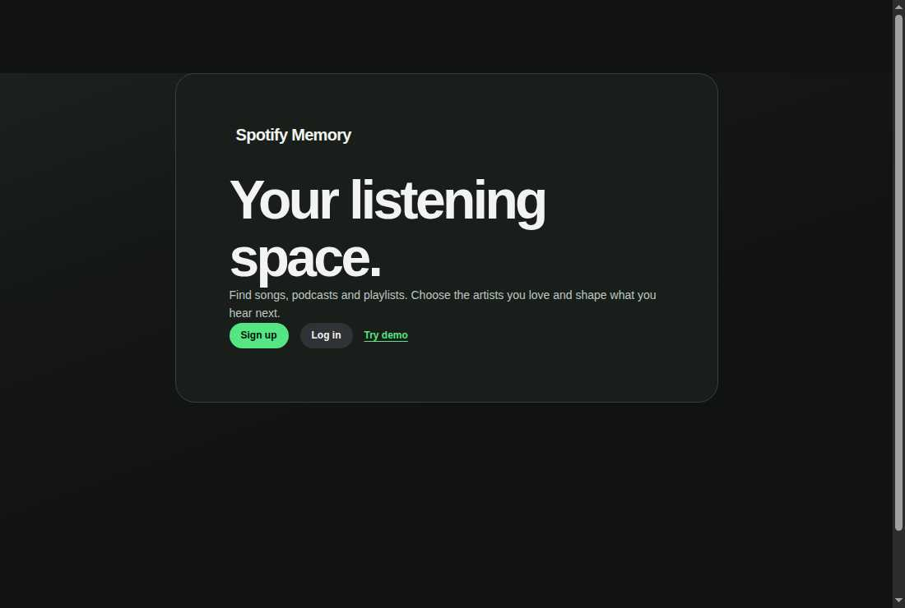
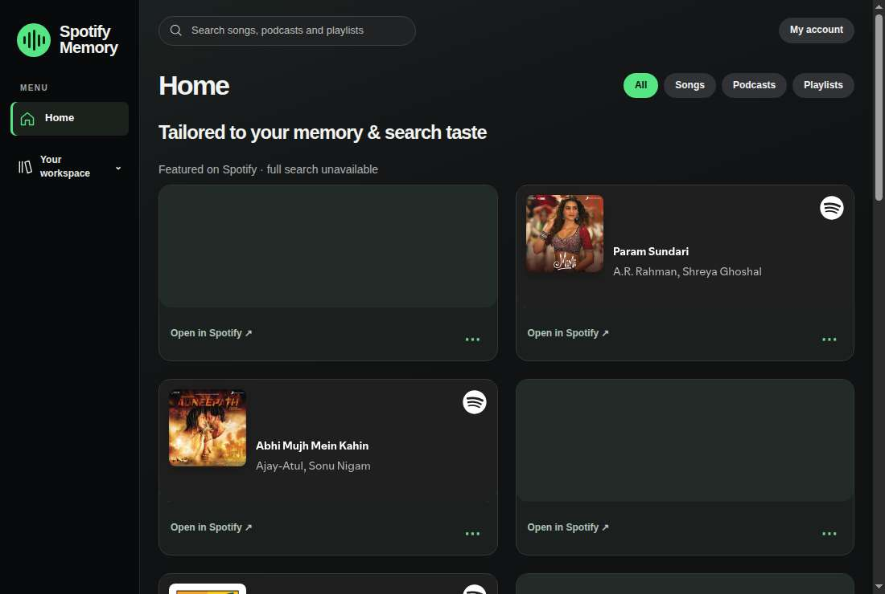
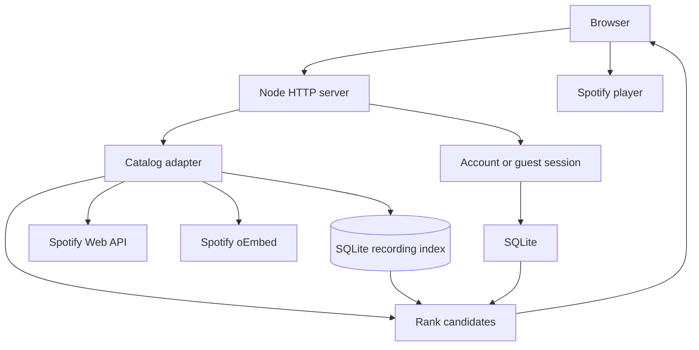

# Spotify Memory

Spotify Memory recommends songs, podcast episodes and playlists using your favourite artists, recent searches and item feedback. Try searching for **Ek Chumma** or **Blinding Lights**, play a result, then use **⋯ → View source** to see why it appeared.

[Open the listening workspace](https://spotify-personalized-ai-memory.onrender.com)



## Listening workflow

Choose **Sign up**, **Log in** or **Try demo**. Each guest gets a fresh workspace. New personal accounts start empty. After signup, enter up to three favourite artists or skip setup. Log in on another device to restore account preferences on the same database.

Home loads automatically. Search for a title or artist, or filter by songs, podcast episodes and playlists. The item’s **⋯** menu contains **View source**, **More like this**, **Less like this** and **Undo feedback**. Press Play directly on a card’s official Spotify player. Each player includes the item's Spotify artwork. The green **Open in Spotify** link opens the same item in Spotify. Starting another player on the same page pauses the previous one. Spotify determines whether a recording offers a preview or full playback. If the play button is unavailable, use **⋯ → Find other recordings** to search for another release of the song.



## How search works

| Input or mode | What the app searches |
|---|---|
| Song title or artist | The server tries Spotify Web API search for the India market. If track search is unavailable, it queries a local SQLite full-text index of **89,740 unique Spotify recordings**. |
| Podcast or playlist name | The server uses Spotify Web API search when available. Matching featured episodes and playlists can still appear when the provider is unavailable. |
| Spotify link or URI | Paste a track, episode or playlist link into Search. The app checks featured items first, then resolves the item through Spotify oEmbed. |
| Empty search | Home combines featured picks with available provider results. Saved taste and feedback determine the order. |

Use **Previous results** and **Next results** to browse additional pages when available. The recording index contains metadata and Spotify IDs; audio plays through Spotify’s embedded player. New releases can fall outside the pinned snapshot.

## Your workspace

Expand **Your workspace** in the sidebar to reveal these four pages.

| Page | Live data and controls |
|---|---|
| Memory controls | See which memory is in use. Edit up to three artists, forget recent searches, undo ratings, pause or clear memory. |
| Quality review | Compare three orderings using this listener’s first positive song ratings and the ranks observed before each vote. |
| Operations | Remembered feed requests, recent search count and current rating count. |
| Schema & policy | Workspace type, current memory status and how stored signals are used. |


## Request flow



The Node 24 server serves HTML, JS, CSS and a same-origin JSON API. SQLite stores salted scrypt password hashes, hashed expiring sessions, rate windows and listener workspace documents. The browser uses a one-day HttpOnly SameSite cookie. New guests receive random identifiers. Opening the player is not recorded as a completed play.

**Catalog sources.** The server refreshes featured titles and artwork through oEmbed up to once per hour. The Docker build downloads a pinned metadata file, deduplicates recordings by Spotify ID and builds the full-text index. Listener data lives in a separate database. [Source dataset](https://huggingface.co/datasets/maharshipandya/spotify-tracks-dataset/tree/635b034f69257814eff850a5c2b3346fe458134f)

**Ranking.** A saved artist match adds three points and a previous search match adds one. More/less feedback adds or subtracts ten for that specific recording or collection. Reasons are generated from those same inputs. Home rotates ties hourly; search keeps provider/featured order for ties. Pausing suspends personal ranking, search-history collection and new ratings. You can still edit or clear saved preferences. Undo removes a rating and its associated ranking observation.

**Evaluation.** Three orderings share the same listener, candidate set and tie-breaker. A song’s first positive vote supplies a held-out target. Each observation records its pre-vote rank, with the latest 500 retained per workspace. Community popularity uses prior positive ratings. Personal Quality review uses that workspace; the offline notebook aggregates account workspaces. A cleared, undone or reversed observation is excluded. The experiment measures observed feedback; small or self-selected samples cannot establish general improvement.

| Method | Published real-account observations | Hit Rate@5 | Mean rank |
|---|---:|---:|---:|
| Community popularity | 0 | — | — |
| Artist and search memory | 0 | — | — |
| Memory with feedback | 0 | — | — |

No production listener sample was exported for this release. Run `npm run evaluate` or [the notebook](analysis/listening_eda.ipynb) against an authorized SQLite copy for current aggregate results.

## API and deployment

| Endpoint | Operation |
|---|---|
| POST /v1/signup, /v1/login, /v1/guest, /v1/logout | Session lifecycle |
| POST /v1/reset-password | Verify email and the saved one-time recovery code, replace the password and revoke previous sessions |
| GET /v1/state | Own preferences, usage, feedback and quality metrics |
| POST /v1/feed | Catalog lookup, candidate rankings, source explanations |
| POST /v1/rate | Rate an item from a specific observed feed |
| POST /v1/memory | Edit artists, forget a search, undo, pause or clear |
| GET /health/ready, /health/live | Check server and database |

### Run locally

With Docker Compose, run `docker compose up --build` from the repository root. The Docker build creates the recording index, and Compose mounts a named volume at `/app/runtime` for account data.

For a local Node 24 installation, run these commands from the repository root. The first command requires Python 3 with SQLite FTS5 and internet access to download the catalog.

```sh
python3 scripts/index-catalog.py backend/catalog-index.sqlite
npm start
```

Open [localhost:8000](http://127.0.0.1:8000). If you skip the indexing command, local fallback search is limited to the featured collection. The Docker image includes the index.

| Server setting | Purpose |
|---|---|
| `SPOTIFY_CLIENT_ID`, `SPOTIFY_CLIENT_SECRET` | Enable live Web API search. Keep both in the server environment or a local ignored `.env` file. |
| `DATABASE_PATH` | Path to the writable listener database. Defaults to `runtime/memory.sqlite`. Use persistent storage to retain accounts across deployments. |
| `HOST`, `PORT` | Listening address and port. The Docker image defaults to `0.0.0.0:8000`. |

The public deployment runs on Render. Its free local filesystem is temporary. A successful login across two devices checks account sharing while the database exists; durability across redeploys requires persistent storage.

### Checks

| Command | What it does |
|---|---|
| `npm test` | Runs account, recovery and ranking tests, plus desktop/mobile browser checks when Chrome or Chromium is available. |
| `npm run evaluate` | Prints account-level aggregate ranking metrics from the database selected by `DATABASE_PATH`. |
| `npm run build` | Copies the server, backend, migrations and frontend into `dist/server`. Generate the catalog index first to include it. |

GitHub Actions runs evaluation, tests, build and syntax checks, builds the Docker image and scans it for vulnerabilities.

### Password recovery

Signup and reset accept 4–128 characters. Save the one-time recovery code shown after signup (existing accounts receive one on their next login). Choose **Forgot password?** on the login screen and enter the account email, saved code and a new password. A successful reset signs out existing sessions and replaces the used code. The server stores only the code digest.
