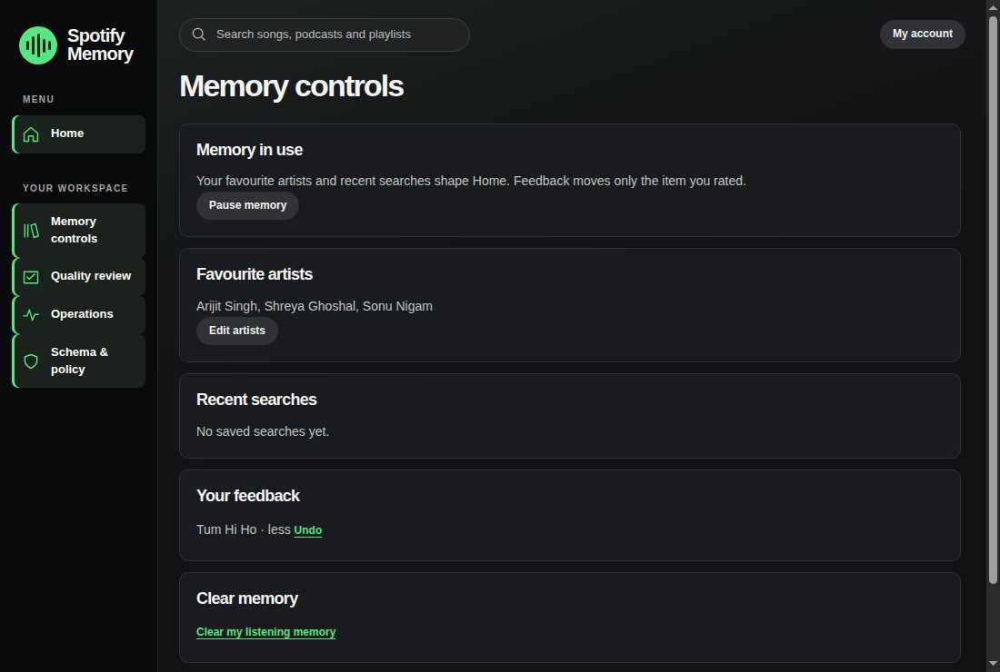
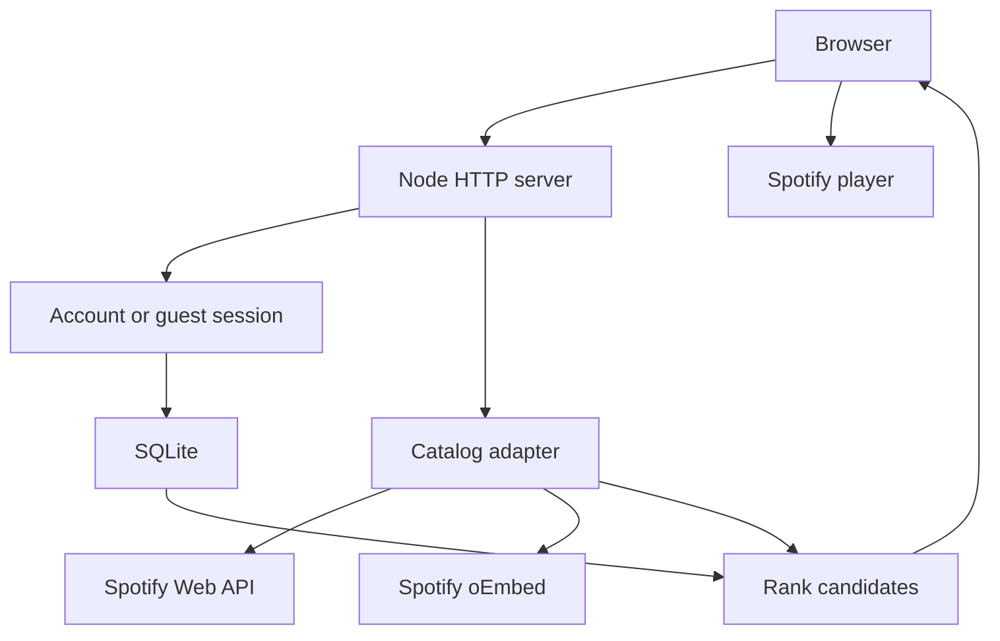

# Spotify Memory

[Open the listening workspace](https://spotify-personalized-ai-memory.onrender.com)

## Listening workflow

Choose **Sign up**, **Log in** or **Try demo**. Each guest gets a fresh workspace. New personal accounts start empty. After signup, enter up to three favourite artists or skip setup. Log in on another device to restore account preferences on the same database.

Home loads automatically. Search for a title or artist, or filter by songs, podcast episodes and playlists. The item’s **⋯** menu contains **View source**, **More like this**, **Less like this** and **Undo feedback**. Press Play directly on a card’s official Spotify player. Each player includes the item's Spotify artwork. The green **Open in Spotify** link opens the same item in Spotify. Playback and preview availability depend on Spotify.

## Your workspace

Expand **Your workspace** in the sidebar to reveal these four pages.

| Page | Live data and controls |
|---|---|
| Memory controls | See which memory is in use. Edit up to three artists, forget recent searches, undo ratings, pause or clear memory. |
| Quality review | Compare three orderings using this listener’s first positive song ratings and the ranks observed before each vote. |
| Operations | Remembered feed requests, recent search count and current rating count. |
| Schema & policy | Workspace type, current memory status and how stored signals are used. |

## Request flow

The Node 24 server serves HTML, JS, CSS and a same-origin JSON API. SQLite stores salted scrypt password hashes, hashed expiring sessions, rate windows and listener workspace documents. The browser uses a one-day HttpOnly SameSite cookie. New guests receive random identifiers. Opening the player is not recorded as a completed play.

**Catalog.** The Web API adapter requests India-market tracks, episodes and playlists. It caches the app token, bounds provider waits and respects rate limiting. A small editorial list of real Spotify links provides discovery while Spotify oEmbed refreshes titles and artwork in the background, at most once an hour. When Spotify Web API search is unavailable, song-title and artist queries use a local full-text index of real Spotify recordings with paginated results. The Docker build generates the index from the pinned [Spotify Tracks metadata dataset](https://huggingface.co/datasets/maharshipandya/spotify-tracks-dataset). Local Node deployments can run `python3 scripts/index-catalog.py backend/catalog-index.sqlite` to install it. Catalog snapshots have finite coverage; Spotify controls playback rights and preview availability. No generated listener histories are shipped.

**Ranking.** A saved artist match adds three points and a previous search match adds one. More/less feedback adds or subtracts ten for that specific recording or collection. Reasons are generated from those same inputs. Home rotates ties hourly; search keeps provider/featured order for ties. Pausing disables personal ranking and new memory writes. Undo removes a rating and its associated ranking observation.

**Evaluation.** Three orderings share the same listener, candidate set and tie-breaker. A song’s first positive vote supplies a held-out target. Each observation records its pre-vote rank, with the latest 500 retained per workspace. Community popularity uses prior positive ratings. Personal Quality review uses that workspace; the offline notebook aggregates account workspaces. A cleared, undone or reversed observation is excluded. The experiment measures observed feedback; small or self-selected samples cannot establish general improvement.

| Method | Published real-account observations | Hit Rate@5 | Mean rank |
|---|---:|---:|---:|
| Community popularity | 0 | — | — |
| Artist and search memory | 0 | — | — |
| Memory with feedback | 0 | — | — |

No production listener sample was exported for this release. Run `npm run evaluate` or [the notebook](analysis/listening_eda.ipynb) against an authorized SQLite copy for current aggregate results.

## API and deployment

| Endpoint | Operation |
|---|---|
| POST /v1/signup, /v1/login, /v1/guest, /v1/logout | Session lifecycle |
| GET /v1/state | Own preferences, usage, feedback and quality metrics |
| POST /v1/feed | Catalog lookup, candidate rankings, source explanations |
| POST /v1/rate | Rate an item from a specific observed feed |
| POST /v1/memory | Edit artists, forget a search, undo, pause or clear |
| GET /health/ready, /health/live | Check server and database |

Use Node 24 and `npm start`. Open http://127.0.0.1:8000. Configure `SPOTIFY_CLIENT_ID` and `SPOTIFY_CLIENT_SECRET` on the server to enable broader catalog search. Store `DATABASE_PATH` on a persistent volume for durable accounts. Docker Compose mounts /app/runtime. Render’s free local filesystem is temporary. App accounts are separate from Spotify logins.

Run `npm test` for ranking and browser checks, `npm run evaluate` for aggregate metrics, and `npm run build` for the deployable server directory. GitHub Actions checks the build, tests, Docker image and vulnerability scan.

### Password recovery

Signup and reset accept 4–128 characters. Save the one-time recovery code shown after signup (existing accounts receive one on their next login). Choose **Forgot password?** on the login screen and enter the account email, saved code and a new password. A successful reset signs out existing sessions and replaces the used code. The server stores only the code digest.
