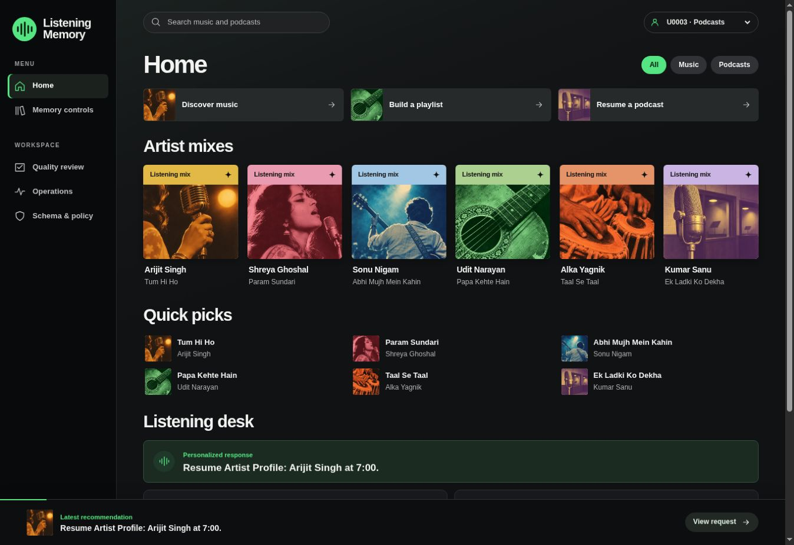
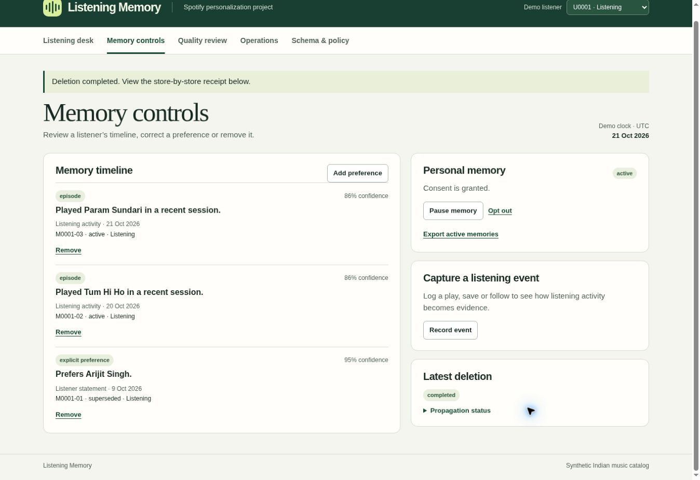
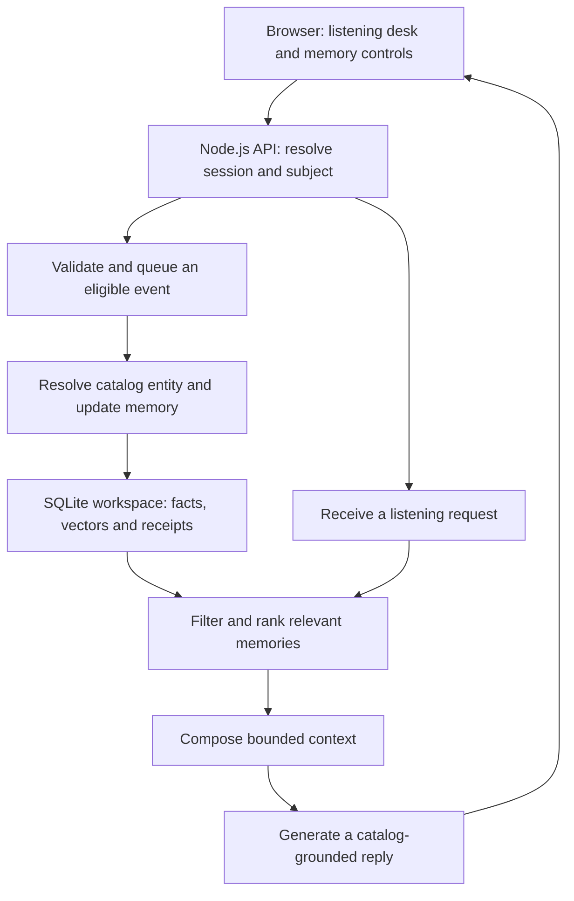

# Spotify: Personalized AI Memory System

**Spotify Memory** is a classroom project that helps a listening assistant decide what to remember between sessions. It uses a supplied Indian music catalog and synthetic histories for 300 listeners. The pilot covers three journeys: music discovery, playlist preferences, and podcast continuation.

For example, a listener can ask what to play next, inspect the preference behind the recommendation, correct their preferred artist, and repeat the same question to see how the answer changes.

**[Open the live application](https://spotify-personalized-ai-memory.onrender.com)** · [Watch the final demo on Google Drive](PASTE_GOOGLE_DRIVE_VIDEO_URL_HERE) · [View the executed EDA notebook](analysis/listening_eda.ipynb)

## Run locally

Install **Node.js 24**. Clone the repository, or extract the project ZIP and open the folder containing `package.json`. The Node.js app uses built-in modules and can start without installing npm packages.

```bash
npm start
```

Open [http://127.0.0.1:8000](http://127.0.0.1:8000) in your browser. The app starts a synthetic demo session. Each reviewer can edit a profile in an isolated workspace.

To run the container locally with Docker Compose:

```bash
docker compose up --build
```

Open the same local address. The Compose configuration mounts a named volume for the SQLite data.

## Try the demo

| Profile | What to try | What to observe |
| --- | --- | --- |
| `U0001` | Open **Home → View request → View source**. | The initial request recommends *Tum Hi Ho*. Its source shows the listener's preference for Arijit Singh. |
| `U0001` | In **Memory controls**, record a play of *Param Sundari*. Then correct the explicit artist preference from Arijit Singh to Shreya Ghoshal and repeat the original request. | A single play records an episode. The explicit correction changes which artist preference can support the next answer. |
| `U0001` | Mark a used episode irrelevant, delete a preference, and inspect the deletion receipt. Then pause memory and ask again. | The receipt reports application-level cleanup. While paused, the assistant can respond with empty personal context. |
| `U0002` | Run the playlist request with memory disabled, then select **Memory on** and repeat it. | Compare the context returned for the same listener and request. |
| `U0003` | Run the podcast continuation request. | The unfinished episode has a saved position of 420 seconds, so the assistant suggests resuming at **7:00**. |
| `U0016` | Run a request with sparse history. | Inspect how the assistant responds when there is little evidence for personalization. |

### Screenshots

**Recommendation and source memories**



**Deletion receipt**



An [earlier recorded walkthrough](docs/walkthrough.mp4) is also included in the repository.

## Architecture

The public Render deployment runs a **Node.js HTTP server in Docker**. It serves the HTML, CSS, browser JavaScript, and backend API from the same application. **SQLite** stores demo sessions and workspace state. The repository also includes a separate Worker build that supports a D1 database binding.



### How a recommendation is produced

1. **Start a session.** The browser selects a synthetic profile. The server binds the session to that listener's workspace and replays its supplied history.
2. **Capture an event.** The backend checks the event contract, subject, consent, and policy. A listener-scoped idempotency key prevents a repeated delivery from creating a second action.
3. **Create or update a memory.** Catalog aliases resolve to stable entity IDs. The system distinguishes explicit preferences, exclusions, temporary episodes, and inferred preferences. Promotion to an inferred preference requires positive evidence across three independent sessions.
4. **Retrieve eligible facts.** The service checks subject, validity period, status, confidence, and permitted surface. It uses catalog relationships and cosine similarity over sparse TF–IDF vectors to rank eligible evidence.
5. **Compose context.** The browser requests up to three memories within a 96-unit estimated context budget. Each selected memory carries its source and a reason for inclusion.
6. **Respond and explain.** By default, catalog rules select an approved reply. The response includes the IDs of the memories used. Feedback, correction, pause, and deletion affect what can be used on a later request.

### Optional model integration

The default demo works without a model server. To exercise the optional Ollama integration, run an Ollama chat model with structured-output support, copy `.env.example` to `.env`, set `OLLAMA_URL` and `OLLAMA_MODEL`, and restart the app.

The extraction adapter can classify an eligible event against a known entity. The reply adapter receives a bounded context package and approved response choices. The backend validates the returned choice and falls back to a catalog reply if the call fails or the output is invalid. Automated model-path tests use controlled responses.

## Data model and memory policy

The original workbook is [data/listening_memory.xlsx](data/listening_memory.xlsx). It includes synthetic listeners, events, catalog data, policies, contracts, and evaluation references. The app builds listener memories by processing events. Workbook annotations and expected answers are used for evaluation.

| SQLite table | What it stores | Why it matters |
| --- | --- | --- |
| `workspaces` | Workspace ID, subject ID, revision, and a serialized document containing temporal facts, vectors, queue state, and receipts | Related changes can commit together. A revision check prevents a stale write from silently overwriting a newer edit. |
| `sessions` | Token digest, workspace ID, reviewer ID, and expiry | Each authenticated request resolves to a particular reviewer's workspace and listener. |
| `rate_windows` | Request scope, time window, and usage count | The service can enforce limits on API and tool calls. |

A memory includes its subject, entity, relationship, source event IDs, confidence, validity period, and status. **Explicit preferences and exclusions last 120 days, inferred preferences last 45 days, and episodes last 7 days.** A correction supersedes the previous fact. Deletion first blocks retrieval, then cleans associated application state and records a receipt.

The four interactive profiles use a moving demo clock anchored near their last historical query. This keeps short-lived examples, such as an unfinished podcast episode, reproducible.

[SQLite schema](drizzle/0000_pilot.sql) · [Storage implementation](backend/store.js) · [Memory rules](backend/memory.js) · [Policy data](data/policy.json)

## API overview

Requests and responses use JSON. Start with `POST /demo/session`. The browser can use its `X-Listening-Session` token or a supported session cookie. CLI clients can request a demo token and send it as `Authorization: Bearer <token>`.

| Method and route | Purpose |
| --- | --- |
| `POST /demo/session` | Start a synthetic listener session. |
| `POST /v1/events` · `GET /v1/events/{id}` | Submit an interaction and inspect its processing receipt. |
| `POST /v1/memories/extract` | Preview how an event would be classified. |
| `GET /v1/memories` · `POST /v1/memories` | Inspect the memory timeline or add an explicit preference. |
| `PATCH /v1/memories/{id}` · `DELETE /v1/memories/{id}` | Correct a memory using its expected graph version or start deletion. |
| `GET /v1/deletions/{id}` | Inspect deletion progress and the receipt. |
| `POST /v1/memories/search` · `POST /v1/context/compose` | Rank eligible memories or inspect the selected context. |
| `POST /v1/respond` | Generate an answer using the current request and eligible context. |
| `POST /v1/explain` · `POST /v1/feedback` | Explain memory use or record feedback about a memory used in a response. |
| `POST /v1/control` · `GET /v1/export` | Change memory controls or export the subject's active memories. |
| `GET /v1/dashboard` · `GET /v1/traces/{id}` | Inspect operational information and an individual trace. |
| `GET /v1/policy` · `GET /v1/quality` | Inspect the policy registry and evaluation results. |
| `POST /v1/replay` | Retry an eligible failed event. |
| `GET /health/live` · `GET /health/ready` | Check that the process responds and that its database is accessible. |

Example request body for `POST /v1/respond` after starting a session:

```json
{
  "utterance": "What should I listen to next?",
  "surface": "listening_ai",
  "locale": "en-IN",
  "max_context_items": 3,
  "context_token_budget": 96
}
```

[HTTP route implementation](backend/routes.js) · [API and operations guide](docs/operations.md)

## MCP tools

The application exposes five subject-scoped tools through `POST /mcp`. A client initializes the connection, lists the available tools, and calls a tool with arguments matching its schema.

| Tool | Purpose |
| --- | --- |
| `search_memory` | Retrieve eligible memories for the current request. |
| `add_explicit_preference` | Save an explicit preference for a recognized catalog entity. |
| `correct_memory` | Replace an active preference after checking its expected version. |
| `delete_memory` | Request erasure of a selected memory. |
| `explain_memory_use` | Explain why a memory was used in a response. |

[Tool schemas and limits](backend/contracts.js) · [Supplied contracts](data/contracts.json)

## Environment variables

| Variable | Purpose |
| --- | --- |
| `HOST` | Interface for the Node.js server. The local default is `127.0.0.1`. The container binds to `0.0.0.0`. |
| `PORT` | HTTP port. The local default is `8000`. The hosting platform can supply its own port. |
| `DATABASE_PATH` | Path to the SQLite database. The local default is `runtime/memory.sqlite`. |
| `RENDER_EXTERNAL_URL` | Public service URL supplied by Render. The server uses it when checking request origins behind the hosting proxy. |
| `OLLAMA_URL` | Optional Ollama server address, for example `http://127.0.0.1:11434` when running directly on the laptop. |
| `OLLAMA_MODEL` | Optional name of the installed Ollama model with structured-output support. |

[Example configuration](.env.example) · [Server entry point](server.js)

## Exploratory data analysis

The [executed EDA notebook](analysis/listening_eda.ipynb) contains seven executed Python cells and three charts. It examines duplicate deliveries, missing fields, event mix, activity per listener, differences across surfaces, delivery delays, confidence, and experiment cohorts.

| Finding | Interpretation |
| --- | --- |
| 664 event deliveries represented 661 distinct actions. | Three deliveries repeated the same listener and idempotency key. Counting deliveries as independent behavior would overstate activity. |
| 264 of 300 listeners had exactly two distinct actions. | **88%** of listeners had sparse histories, which limits how confidently a single play can be interpreted. |
| 334 of 661 distinct actions were AI interactions. | About **50.5%** of actions were AI interactions. A question can express immediate intent without establishing a durable preference. |

Saved notebook outputs can be viewed directly on GitHub. To rerun the analysis with Python 3.12 from the repository root:

```bash
python -m pip install -r analysis/requirements.txt
python -m jupyterlab analysis/listening_eda.ipynb
```

## Evaluation and testing

| Check | Recorded result |
| --- | --- |
| Golden cases covering ranking, context, policy, fallback, and controls | 81/81 passed |
| Context records matching expected facts, timestamps, types, lineage, and relevance reasons | 37/37 |
| Exact confidence values matching workbook annotations | 12/37 |
| Graph checks | 81/81 |
| Extraction checks | 147/147 |
| Entity-resolution checks | 113/113 |
| Prohibited records returned in the golden evaluation | 0 |
| Automated regression and integration tests | 19/19 passed |
| Recorded local HTTP P95 | 5.72 ms for 50 distinct queries and 2.83 ms for 50 repeated queries |

The service uses deterministic confidence scores. Exact numerical agreement with workbook annotations is reported separately from the main golden-case decisions. The latency measurements describe a local benchmark. Hosted concurrent performance and real-listener outcomes require separate evaluation.

Run the checks from the repository root:

```bash
npm run evaluate
npm test
npm run build
node scripts/benchmark.js
```

[Per-case results](docs/quality.json) · [Test log](docs/test-results.txt) · [Local latency measurements](docs/local-latency.json) · [Automated tests](tests/pilot.test.js)

## Project structure

| Path | Responsibility |
| --- | --- |
| `frontend/` | Browser interface for listening requests, sources, memory controls, quality, operations, and policy. |
| `server.js` | Node.js entry point, static assets, database setup, and recovery timer. |
| `backend/routes.js`, `backend/contracts.js` | HTTP routes, session checks, MCP requests, schemas, and tool limits. |
| `backend/service.js`, `backend/replay.js` | Event queue, processing, replay, scoped cache, feedback, and traces. |
| `backend/extraction.js`, `backend/memory.js` | Event classification, memory lifecycle, correction, expiry, and deletion. |
| `backend/catalog.js`, `backend/retrieval.js` | Catalog aliases and relationships, sparse vectors, eligibility checks, ranking, and context selection. |
| `backend/reply.js` | Catalog-grounded replies and optional Ollama response selection. |
| `backend/store.js`, `backend/local-db.js`, `drizzle/0000_pilot.sql` | Workspace persistence, local SQLite access, and schema. |
| `data/`, `analysis/`, `scripts/prepare_data.py` | Source workbook, prepared JSON, data preparation, and EDA notebook. |
| `tests/`, `docs/` | Regression tests, evaluation evidence, screenshots, walkthrough, and operations notes. |
| `Dockerfile`, `compose.yaml`, `.github/workflows/checks.yml` | Runtime image, local container setup, and CI checks. |

## Deployment and CI

The public service is deployed from GitHub to [Render](https://spotify-personalized-ai-memory.onrender.com). The Docker image runs `node server.js` as a non-root user. [Service readiness endpoint](https://spotify-personalized-ai-memory.onrender.com/health/ready)

GitHub Actions runs golden evaluation, automated tests, a build, a syntax check, a Docker image build, and a Trivy image scan. Dependabot proposes updates to Docker and GitHub Actions dependencies. Each workflow result belongs to the branch and commit shown on that run.

[CI workflow](.github/workflows/checks.yml) · [Operations and recovery notes](docs/operations.md)

## Limitations

- All listener histories are synthetic. The app uses its own demo sessions. Spotify account authorization, real-time Spotify activity, and audio streaming are outside this pilot.
- The default answer generator uses catalog rules. Automated tests exercised the optional Ollama adapter with controlled responses. Live model weights were unavailable in the verification environment.
- Retrieval uses catalog relationships, known aliases, and sparse TF–IDF vectors. Coverage of unfamiliar wording, Hindi, and Hinglish is limited to the catalog and tested examples.
- Application-level deletion and cleanup are tested. Physical erasure from provider backups has not been independently verified.
- The free Render deployment has no persistent disk configured. Hosted demo edits may be lost when the instance is replaced.
- Production identity, large-scale concurrent load, real-listener satisfaction, retention uplift, and the proposed two-week controlled validation window require further evidence.

## Team contributions

| Team member | Contribution | Evidence |
| --- | --- | --- |
| Dibyajyoti Roy | [Enter the specific implementation, analysis, test, or review completed.] | [Add the relevant file, commit, or review link.] |
| Jaspreet Kaur Sharma | [Enter the specific implementation, analysis, test, or review completed.] | [Add the relevant file, commit, or review link.] |
| Gagan Joshi | Published the project to GitHub, configured the Render deployment, and troubleshot the hosted request-origin issue. | [Render origin fix](https://github.com/joshigagan822-png/spotify-personalized-ai-memory/commit/7c55dbe) · [Live application](https://spotify-personalized-ai-memory.onrender.com) |
