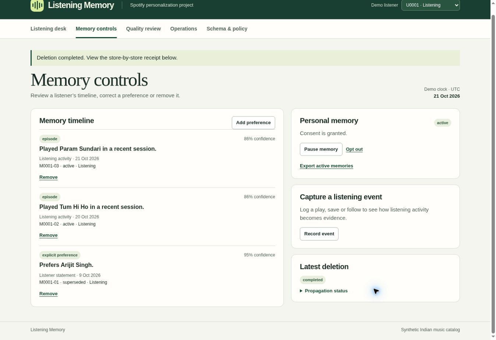

# API and operations

Run npm start locally, or use compose.yaml with Docker Compose. Docker is supplied as a packaging option. The Node server was directly tested. HOST, PORT and DATABASE_PATH configure the local server. Hosted Workers use a DB binding. Run /health/live and /health/ready after deployment. Workspaces use synthetic data and expire individual sessions after 24 hours.

## Subject-bound clients

POST /demo/session with {"subject_id":"U0001","client":"cli"} to issue a new isolated demo bearer token. Send Authorization: Bearer TOKEN on subsequent requests. The browser sends its scoped demo token in the X-Listening-Session header. It can use an HttpOnly same-site cookie when cookies are available. Each issued session is bound to one subject in one reviewer's workspace. Send JSON for writes including DELETE.

| Endpoint | Action |
| --- | --- |
| POST /v1/events, GET /v1/events/{id} | Accept an event envelope and inspect its processing receipt |
| POST /v1/memories/extract | Preview event extraction without committing |
| POST or GET /v1/memories | Record a catalog preference or view the timeline |
| PATCH or DELETE /v1/memories/{id} | Correct an active preference with optimistic version checking or start erasure |
| GET /v1/deletions/{id} | Review store-by-store progress and backup policy |
| POST /v1/memories/search, /v1/context/compose, /v1/respond | Rank candidates, inspect context or request a response |
| POST /v1/explain, /v1/feedback | Explain a used memory or record explicit relevance feedback |
| POST /v1/control, GET /v1/export | Pause, resume, opt out, grant consent or export active memories |
| GET /v1/dashboard, /v1/traces/{id}, /v1/policy, /v1/quality | Inspect redacted telemetry, trace, policies and evaluation |
| POST /v1/replay | Retry a recoverable dead-letter event by ID |

Search body example: {"utterance":"What should I listen to next?","surface":"listening_ai","locale":"en-IN","max_context_items":3,"context_token_budget":96}. Preference example: {"entity_id":"artist_02","polarity":"positive","surface":"listening_ai","idempotency_key":"practice-01"}. Corrections require replacement_entity_id, expected_graph_version and a new idempotency_key.

POST /mcp provides stateless Streamable HTTP with protocol version 2025-06-18. Initialize, send notifications/initialized, then tools/list and tools/call. The five tools are search_memory, add_explicit_preference, correct_memory, delete_memory and explain_memory_use. Executable input/output schemas and per-tool quotas are in backend/contracts.js. The workbook's contract export is in data/contracts.json.

## Privacy and recovery

Explicit preferences and exclusions last 120 days, episodes 7 days and inferred preferences 45 days. A 14-day candidate requires three independent positive sessions for promotion. The policy registry supplies the thresholds. Only eligible adult IN listeners with granted consent receive context on the originating surface. The model payload has a 4 KiB ceiling in addition to the workbook context-unit budget.

The queue commits before processing. Check Operations for lag and failures. A dead letter can be retried with its original event and key. A local timer resumes work after a restart. Hosted work can also resume on subsequent requests. A missing index, disabled cohort or paused listener yields empty context.

Deletion immediately removes retrieval eligibility, then erases graph content and redacts operational references. The backup field records the workbook's 30-day restriction. Physical provider backup erasure has not been independently verified. Restore an earlier compatible code version for rollback and rerun isolation and erasure tests. Preserve later deletion receipts when recovering data.

[Model Context Protocol transport](https://modelcontextprotocol.io/specification/2025-06-18/basic/transports) · [Ollama structured outputs](https://docs.ollama.com/capabilities/structured-outputs)
